# Budgie

Budgie is a mobile app for tracking a household's expenses together. Everyone in a household logs what they paid (or photographs the receipt and lets Budgie fill in the expense), recurring bills are added on schedule, and you can see where the month's money went, by category, by payer and over time.

<table>
  <tr>
    <td align="center">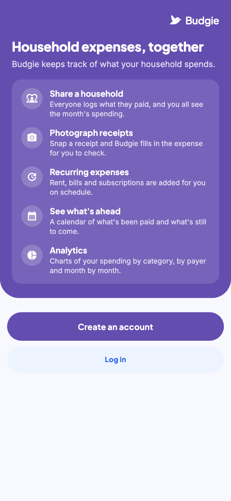<br><sub>Welcome</sub></td>
    <td align="center">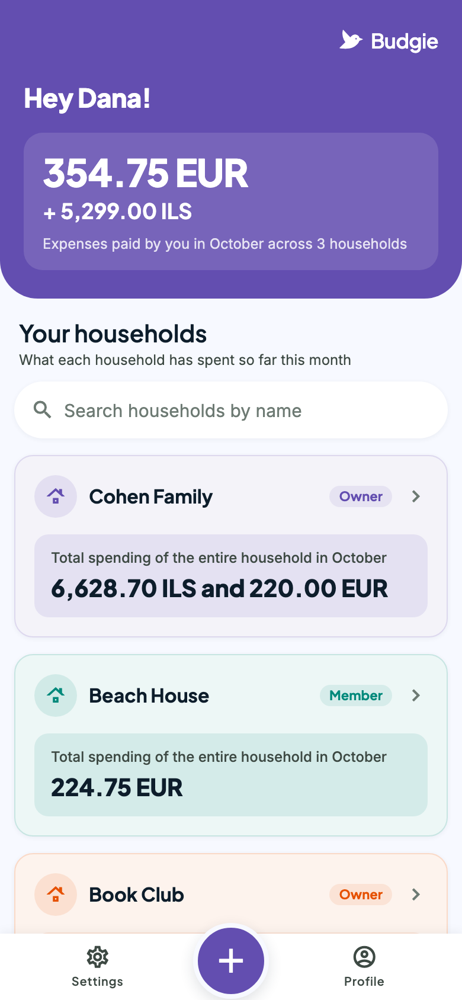<br><sub>Your households</sub></td>
    <td align="center">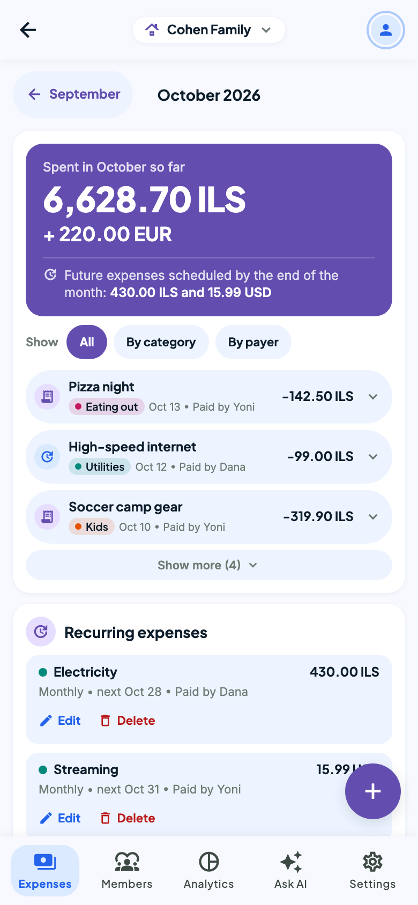<br><sub>A household's month</sub></td>
    <td align="center">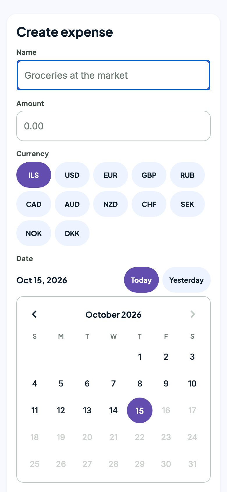<br><sub>Create expense</sub></td>
  </tr>
  <tr>
    <td align="center">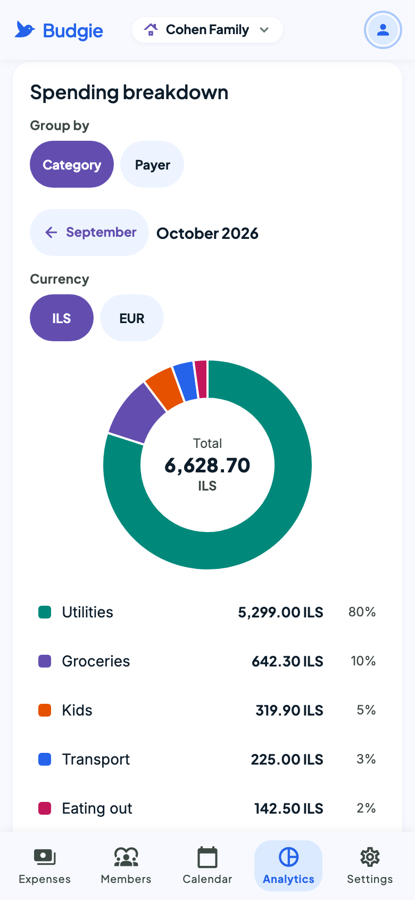<br><sub>Analytics and budget</sub></td>
    <td align="center">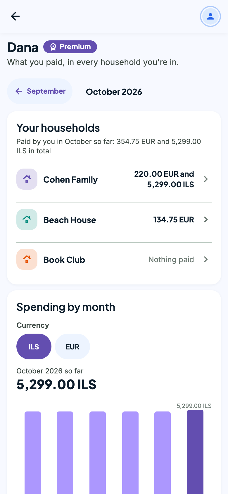<br><sub>Profile</sub></td>
    <td align="center">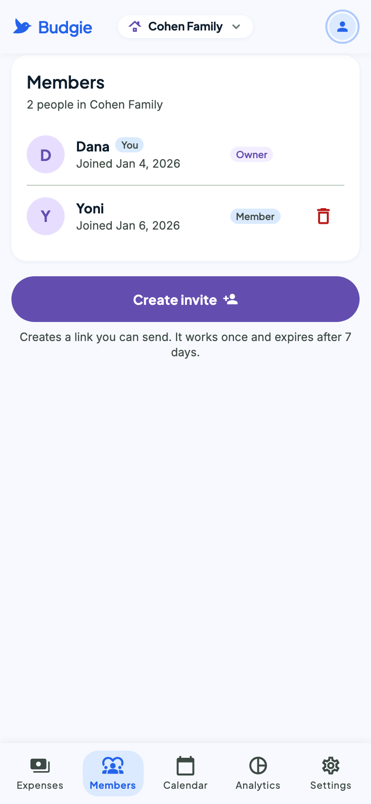<br><sub>Members</sub></td>
    <td align="center">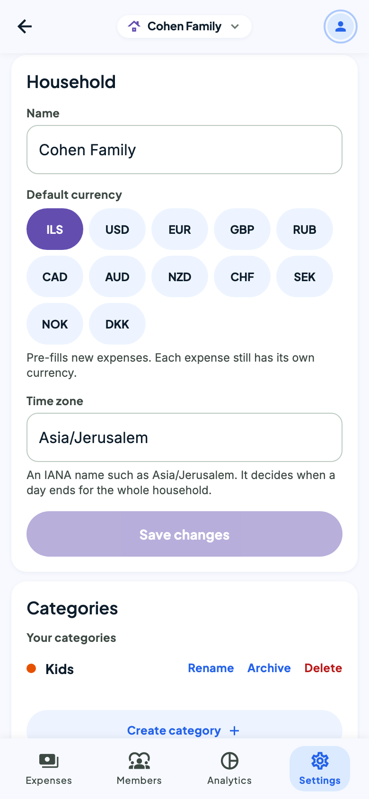<br><sub>Household settings</sub></td>
  </tr>
  <tr>
    <td align="center">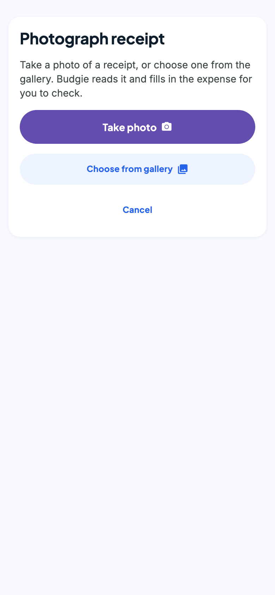<br><sub>Photograph a receipt</sub></td>
    <td align="center">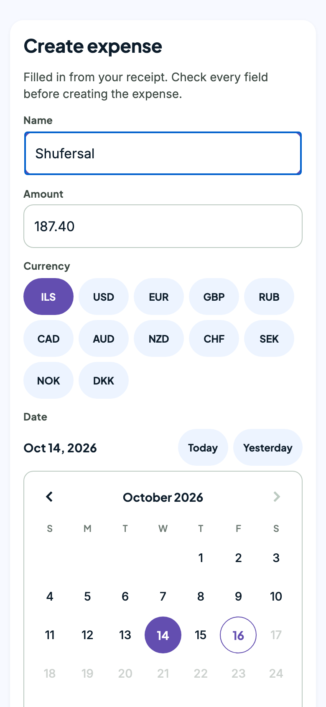<br><sub>Filled in from the receipt</sub></td>
    <td align="center">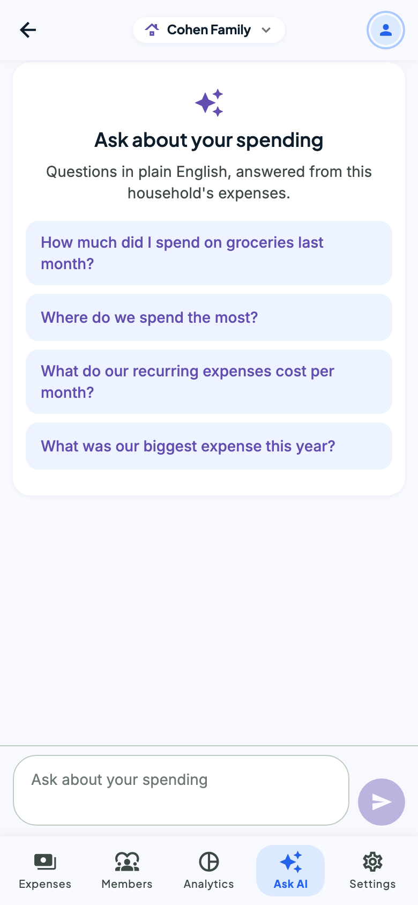<br><sub>Ask AI</sub></td>
    <td align="center">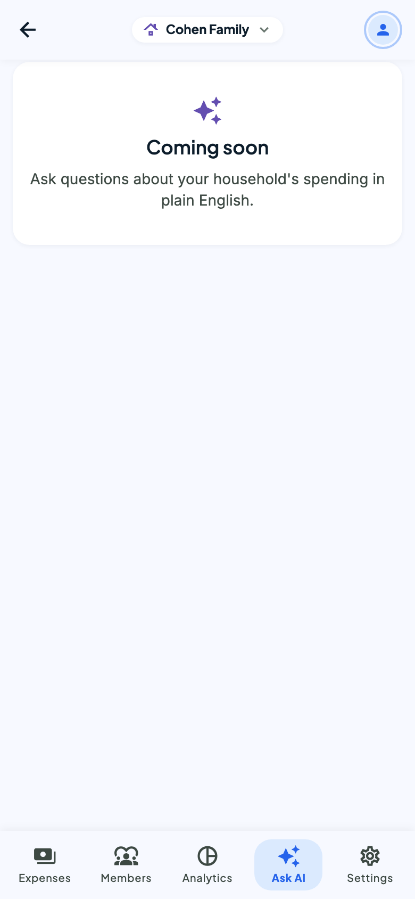<br><sub>Ask AI answering</sub></td>
  </tr>
</table>

<sub>Screenshots use the app's fixture mode (made-up data, no backend).</sub>

## Features

- **Households.** Create a household with a default currency, a time zone and an optional monthly limit, and share it with others. Each person can belong to several households.
- **Members and invites.** Owners create single-use invite links that expire after 7 days (tapping one opens the app, or the Play Store if it isn't installed), remove members and manage the household. Members can leave, and if the last owner leaves, another member becomes owner.
- **Expenses.** Log an expense with its amount, currency, date (picked on a calendar), category, payer and an optional description. The payer, the creator or an owner can edit or remove it. Expenses can't be dated in the future.
- **Photograph receipts.** Take a photo of a receipt or pick one from the gallery. Budgie reads the store, total, currency, date, items and a likely category, and opens the expense form filled in for you to check before saving. The photo is shrunk on the phone, uploaded straight to private storage and deleted as soon as it has been read.
- **Recurring expenses.** Daily, weekly, every two weeks, monthly or yearly, with an optional end date. Past occurrences are filled in when one is created. Upcoming ones appear on the calendar but aren't counted as spent until they're due.
- **Month view.** Each household's month has the total spent, what's still scheduled, the expense list (filter by category or payer), the recurring expenses and a calendar with category-colored dots. Arrows step back through earlier months.
- **Categories.** Built-in categories, plus each household's own, which can be renamed, archived or deleted.
- **Monthly budget.** An optional monthly limit in the household's default currency, which owners set, change or remove. The Analytics tab shows how much of it the month's expenses used, as an amount and a percentage that can pass 100%, on a bar that turns amber from 80% and red once the limit is passed. Only expenses in the default currency count.
- **Analytics.** A month's spending by category or payer as a donut chart, and the household's total for each of the last 6 months.
- **Profile.** What you paid in each of your households, month by month.
- **Multiple currencies.** Amounts are kept per currency and never converted or added across currencies.
- **Accounts.** Sign up with email and a confirmation code (AWS Cognito), reset a forgotten password, change your name and password, and log out.
- **Ask AI.** Ask about the household's spending in plain English: "How much did I spend on groceries last month?", "Where do we spend the most?", "What do our recurring expenses cost per month?". Follow-ups such as "and in March?" keep the context. The model never sees the database: it picks from a fixed set of queries (totals, monthly averages, biggest expenses, top categories, peak month, recurring costs, last purchase), and every number in the answer comes from those queries, per currency and only for your household. Premium only, up to 20 questions an hour.
- **Premium.** Premium accounts can use Ask AI, get 10 receipt scans a day instead of 3, and have a Premium badge on their profile. Others see an invitation to join instead of the chat. Premium is a monthly subscription: it can be canceled in Settings and stays active until the end of the paid month, and a cancel can be undone until then. Joining is set in the database for now; the app's "Join premium" shows a coming-soon screen.

Coming next: monthly reports, notifications for the household, and a way to become premium.

## Tech stack

| Part | Built with |
|---|---|
| Mobile app | React Native with Expo (SDK 57), Expo Router, TypeScript, React Query, `react-native-svg` |
| Backend API | TypeScript, Express 5, Node (ESM) |
| Database | PostgreSQL 16 with Prisma 7 (`pg` driver adapter) |
| Auth | AWS Cognito (the app's own sign-in screens; the API verifies ID tokens) |
| Receipts | AWS S3 (presigned uploads, images deleted after reading), the OpenAI API (reads the receipt), `expo-image-picker` and `expo-image-manipulator` on the phone |
| Ask AI | The OpenAI Responses API with function calling over predefined, household-scoped SQL queries (Prisma `$queryRaw`) |
| Tests | Vitest (with Supertest against a real Postgres database for the API) |

## Repository layout

```
apps/
  api/      Express API: prisma/ (schema, migrations, seed), src/ (routes, services, middleware), tests/
  mobile/   Expo app: app/ (screens), src/ (API client, components, charts, helpers), tests/
docs/
  screenshots/
claude.md   detailed design notes: data model, every endpoint, and the app's conventions
```

The two apps are separate npm projects with no workspaces. Run each one's commands from its own folder.

## Getting started

### Prerequisites

- Node.js and npm
- Docker, for the local database
- An AWS Cognito user pool with an app client that has no client secret and has self-registration turned on
- For receipts: an S3 bucket (with a lifecycle rule that expires leftover `receipts/` images), AWS credentials allowed `s3:PutObject`, `s3:GetObject` and `s3:DeleteObject` on `receipts/*` and `s3:ListBucket` on the bucket, and an OpenAI API key (also used by Ask AI)
- For the app: Xcode (iOS) or Android Studio with an emulator. The app uses native modules, so it runs as an Expo development build, not in Expo Go.

### Database

```bash
docker run --name expenses-db -e POSTGRES_PASSWORD=dev -p 5432:5432 -d postgres:16
docker exec expenses-db psql -U postgres -c "create database expenses" -c "create database expenses_test"
```

### API (`apps/api`)

```bash
cd apps/api
npm install
cp .env.example .env    # then fill in the values (see below)
npx prisma generate
npm run db:migrate      # apply the migrations
npm run db:seed         # the built-in categories
npm run dev             # http://localhost:3000 (or PORT)
```

`.env` needs `DATABASE_URL`, `AWS_REGION`, `COGNITO_USER_POOL_ID`, `COGNITO_CLIENT_ID`, `S3_BUCKET`, `OPENAI_API_KEY`, `OPENAI_RECEIPT_MODEL`, `OPENAI_ASK_MODEL` (the model for Ask AI, `gpt-5.4-mini`) and optionally `PORT`. AWS credentials come from the usual AWS SDK sources (environment, profile or role); on Railway, which has no AWS role, set `AWS_ACCESS_KEY_ID` and `AWS_SECRET_ACCESS_KEY`. A second Railway service runs the daily cleanup of old invites and ended premium subscriptions (`node dist/src/jobs/dailyCleanup.js` on the cron schedule `0 3 * * *`) and needs only `DATABASE_URL`. Railway settings are kept in the dashboard, not in config files. Never commit it.

### Mobile app (`apps/mobile`)

```bash
cd apps/mobile
npm install
cp .env.example .env    # EXPO_PUBLIC_API_URL, EXPO_PUBLIC_COGNITO_USER_POOL_ID, EXPO_PUBLIC_COGNITO_CLIENT_ID
npx expo run:ios        # or: npx expo run:android
```

`EXPO_PUBLIC_*` values are bundled into the app, so they must never hold secrets. An Android emulator reaches your computer at `http://10.0.2.2:<port>`, and a physical device needs your computer's LAN IP.

**Fixture mode.** To see the app without a backend or Cognito, build with `EXPO_PUBLIC_FIXTURES=true`. It answers every request from built-in made-up data. On the web build (`EXPO_PUBLIC_FIXTURES=true npx expo export --platform web`), `?fixture=home`, `empty` or `signedOut` picks the scenario. This is how the screenshots above were taken.

## Tests

```bash
# API: needs DATABASE_URL pointing at a database whose name ends in _test, with the migrations applied
cd apps/api
npx prisma migrate deploy
npx vitest run

# Mobile: unit tests for the pure modules (money, dates, validation, charts, filters, permissions, receipts)
cd apps/mobile
npx vitest run
npx tsc --noEmit
```

The API tests run against the real Express app and a real database, with Cognito replaced by a test header S3 presigning mocked and the OpenAI calls mocked (no AWS or OpenAI requests). Never point them at the development database.

## API at a glance

Every route needs a Cognito ID token (`Authorization: Bearer <token>`).

| Area | Routes |
|---|---|
| You | `GET/PATCH /me`, `GET /me/households`, `GET /me/spending?month=`, `POST /me/premium/cancel` and `/resume` |
| Households | `POST /households`, `GET/PATCH/DELETE /households/:id`, members list, leave, remove |
| Invites | create, list and cancel on `/households/:id/invites`; `POST /households/join/preview`, `POST /households/join` |
| Categories | `/households/:id/categories` (create, list, rename or archive, delete) |
| Expenses | `/households/:id/expenses` (create, list with filters and cursor pagination, get, update, delete) |
| Recurring expenses | `/households/:id/rules` (create, list, get, update, delete) |
| Month views | `GET /households/:id/calendar?month=`, `GET /households/:id/summary?month=` |
| Receipts | `POST /households/:id/receipts` (a presigned upload URL), `POST /households/:id/receipts/analyze` (the suggested expense) |
| Ask AI | `POST /households/:id/ask` (premium; a question and the recent chat, answered from the household's data) |

[claude.md](claude.md) documents every endpoint, its rules and error responses, and the data model behind them.
